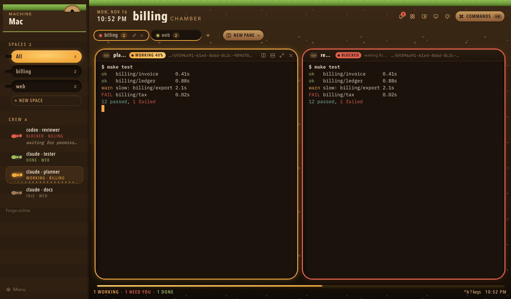
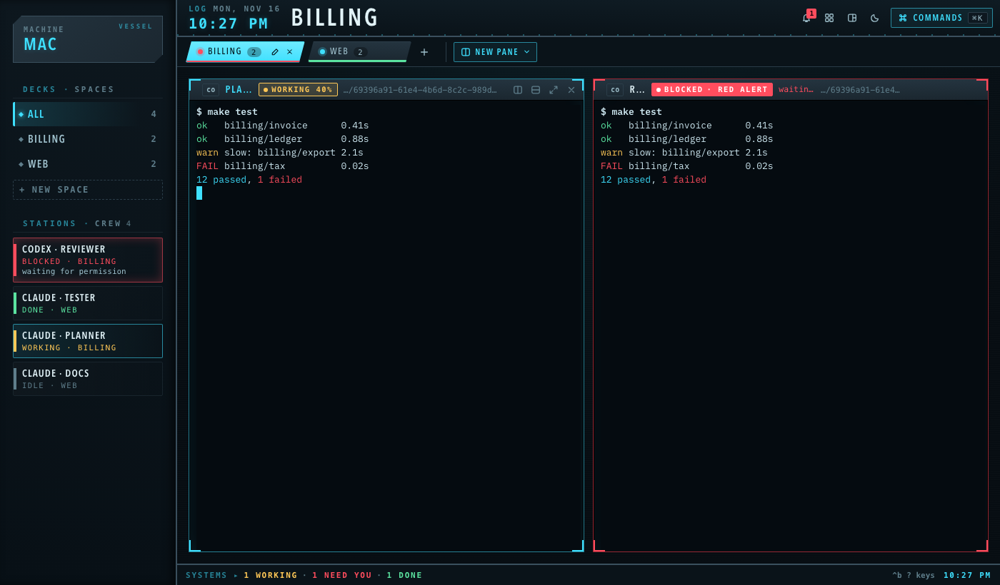
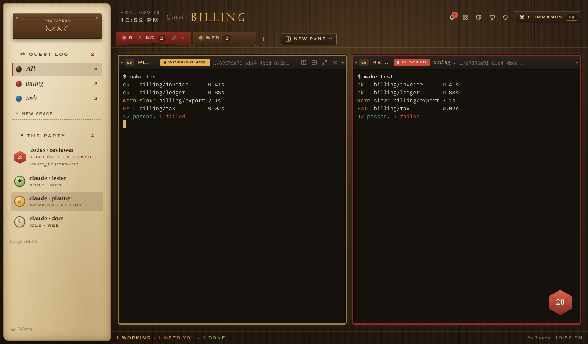
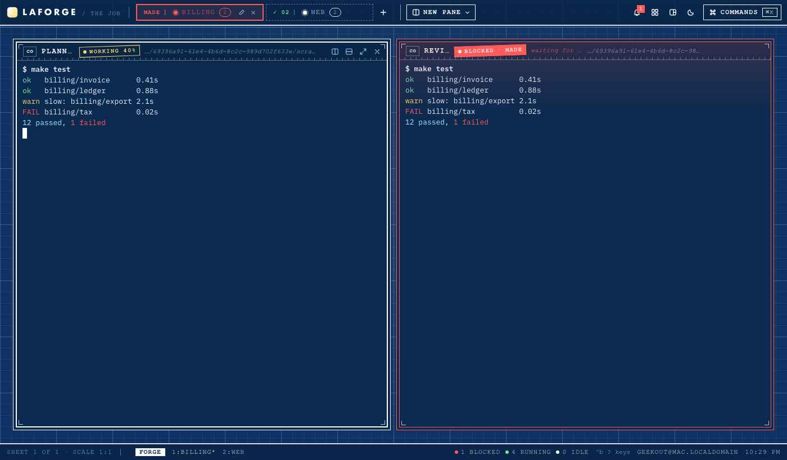
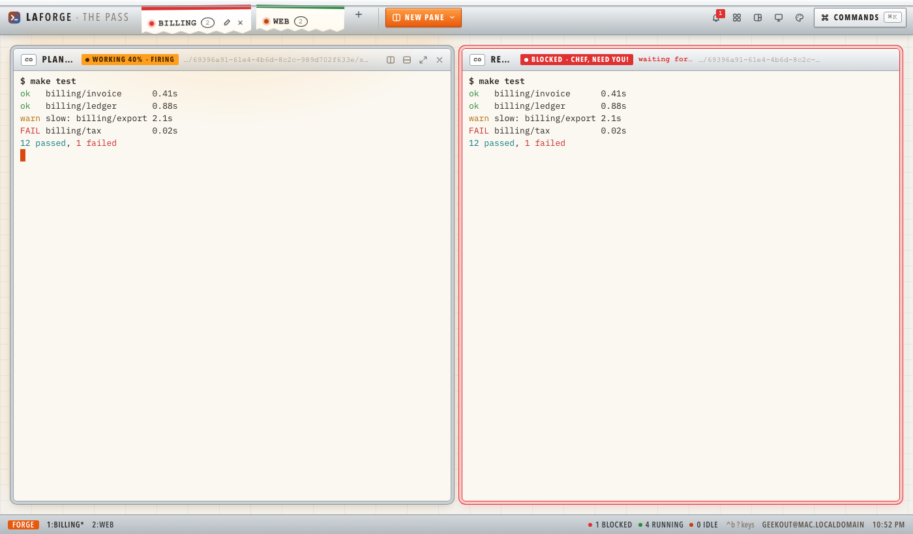
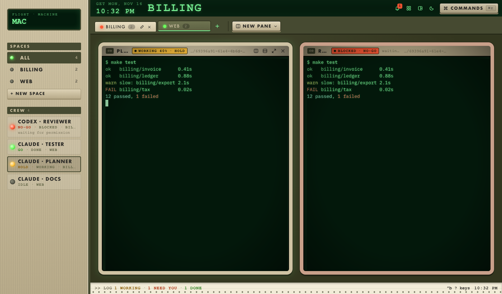
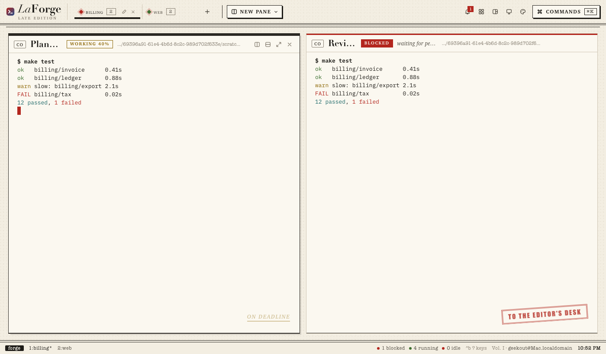

<!-- SPDX-License-Identifier: Apache-2.0 -->
<!-- SPDX-FileCopyrightText: 2026 COR Holdings, LLC -->

# Skin gallery

Skins you can install into any forge. Each one is a folder of stylesheets and
images (no code, no fonts from the network) built on the hooks in
[docs/skins.md](../docs/skins.md). They are LaForge's **official** collection:

```
la skin browse official        # what it offers
la skin install official       # all of them, or official/bridge for one
la skin use bridge             # or pick "Skin: Bridge" in ⌘K
```

Every skin draws both light and dark (the viewer picks; each preview shows
the mode it was first drawn in), and the same four states its own way:
**working**, **blocked** (needs you), **done** and **idle**.

| Skin | Suggests | First drawn in | The idea |
| --- | --- | --- | --- |
| [Ant Colony](ant-colony/) | rail | dark | A cross-section of the nest: soil strata, chambers for panes, the crew as ants and a glowing scent trail on whatever is busy. Animated scene: ants run the tunnels by status. |
| [Bridge](bridge/) | rail | dark | A ship's bridge: cold steel bezels, cyan readouts, crew at their stations, red alert when someone needs you. |
| [Dungeon Party](dungeon-party/) | rail | dark | A candlelit tavern table: a parchment roster of adventurers, a quest log of spaces, and a d20 when only you can roll. |
| [Heist Crew](heist-crew/) | classic | dark | The job on a blueprint: white line work on a blue grid, every tab a step of the plan, red when someone's been made. |
| [Kitchen Pass](kitchen-pass/) | classic | light | Tabs are order tickets on a rail, panes are stainless stations under heat lamps, and blocked calls for Chef. |
| [Mission Control 1969](mission-control-1969/) | rail | dark | Green phosphor screens in beige consoles, go/no-go lamps for every station, a teleprinter strip of the log. |
| [Newsroom](newsroom/) | classic | light | Newsprint and ink: a masthead, serif headlines, column rules, and stamps for the editor's desk and the press. |

| | |
| --- | --- |
|  |  |
|  |  |
|  |  |
|  | |

Want to add one? Copy a folder, rename it (the folder name and `name` in
`skin.json` must match), scope every rule to `[data-skin='<name>']`, and run
`la skin install` on it: the forge refuses anything that is not data.
