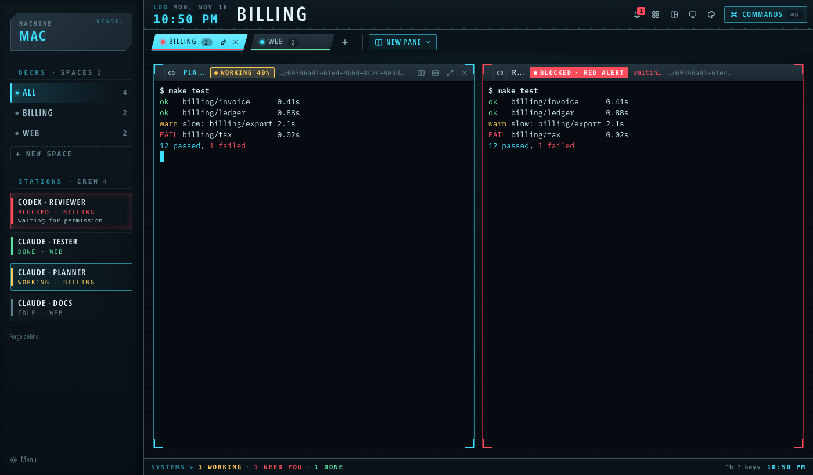

# Bridge

A ship's bridge at night, for the rail layout. Every pane is an instrument
screen with steel corner brackets. The rail is the station console: the
vessel's name, the **Decks** (spaces) and the **Stations** (crew). A sonar
sweep crosses the header, which also carries the log date. The footer reads
out ship's systems. Cyan readouts and condensed faces, all from the system's
own fonts; nothing is loaded from the network.

Both modes: **dark** is the night watch (cyan readouts on black steel), **light** is the day watch (pale steel, navy ink, deep-teal readouts).

| State | On the bridge |
| --- | --- |
| working | amber readout, amber underline on the tab |
| blocked / error | **red alert**: red brackets, a pulsing station, a red tab, `BLOCKED · RED ALERT` |
| done | green readout and tab underline |
| idle | dimmed steel |

Install:

    la skin install ./skins/bridge
    la skin use bridge

