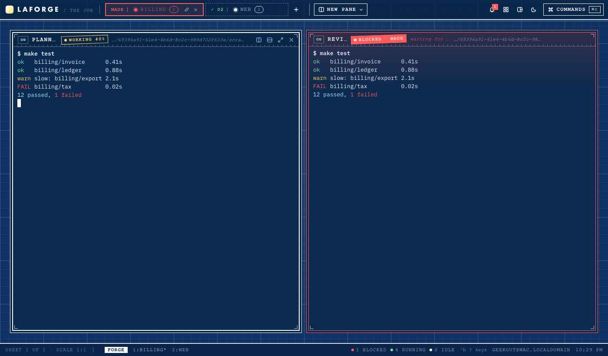

# Heist Crew

The job, drawn on a blueprint, for the classic layout. A blue ground carries a
fine and a coarse grid. Panes are drawings framed in white line work, with
registration ticks at the corners and a dimension rule under each header.
Every tab is a numbered step of the plan (`STEP 01`, `STEP 02`, …), and the
footer is the drawing's title block. Labels use a typewriter monospace,
headings a geometric face, all from the system's own fonts.

| State | On the job |
| --- | --- |
| working | yellow outline on the step, a yellow stamp on the pane |
| blocked / error / failed | **made by security**: the step reads `MADE`, the pane is outlined in red and a red searchlight sweeps it, `BLOCKED · MADE` stamp |
| done | the step is ticked off in green: `✓ 02` |
| idle | dashed outline, faded ink |

Install:

    la skin install ./skins/heist-crew
    la skin use heist-crew

