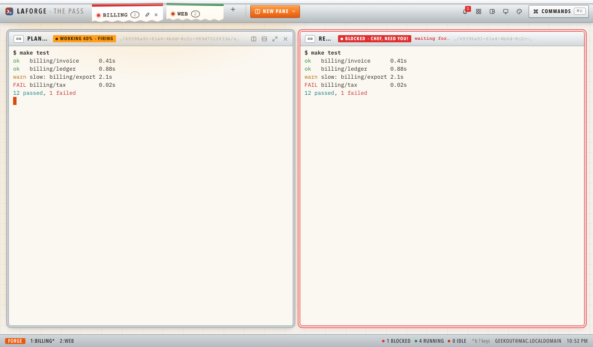

# Kitchen Pass

The line on a busy night, for the classic layout in light mode. The top bar is
the ticket rail: brushed steel, with every tab an order ticket clipped to it,
tilted a little, with a torn edge and a coloured band for its state. Panes are
stainless stations with paper-white bodies on a white tile wall. A station
that is cooking glows under the heat lamp. The footer is the steel shelf of
the pass. Faces come from the system's own fonts.

Both modes: **light** is the line on a busy night, **dark** is closing time (gunmetal steel and slate tile, the tickets still white under the heat lamps).

| State | On the line |
| --- | --- |
| working | the station glows amber under the heat lamp; `WORKING · FIRING`; amber band on the ticket |
| blocked / error | **Chef, need you!**: red station, a red band on a fluttering ticket, `BLOCKED · CHEF, NEED YOU!`; Allow reads `Yes, Chef` |
| done | green band, `DONE · SERVICE!` |
| idle | grey band, plain steel |

Install:

    la skin install ./skins/kitchen-pass
    la skin use kitchen-pass

