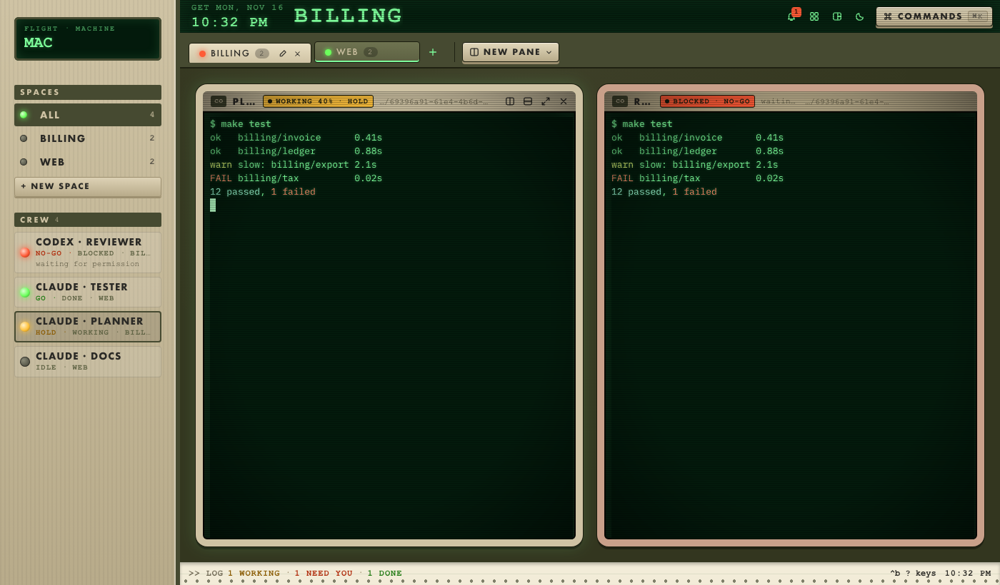

# Mission Control 1969

A flight control room, drawn for the spaces in the rail (it styles them on top too). The rail is a beige console with
round indicator lamps, one per space and one per station of the crew. Panes
are green phosphor screens set deep in beige bezels, with scanlines, a soft
bloom and darkened corners. Tabs are push-button keys that stay pressed while
they are active. The header is a wall display, and the footer is a strip of
teleprinter paper with tractor-feed holes. Faces come from the system's own
fonts.

Both modes: **dark** is the room in flight (green phosphor on black glass), **light** is the room with the lights up (painted walls, daylight on the glass, dark-green phosphor).

| State | In the room |
| --- | --- |
| working | amber lamp, blinking: `HOLD` |
| blocked / error | red lamp, blinking fast: `NO-GO`; Allow and Deny read `GO` and `NO-GO` |
| done | green lamp, steady: `GO` |
| idle | unlit lamp |

Install:

    la skin install ./skins/mission-control-1969
    la skin use mission-control-1969

